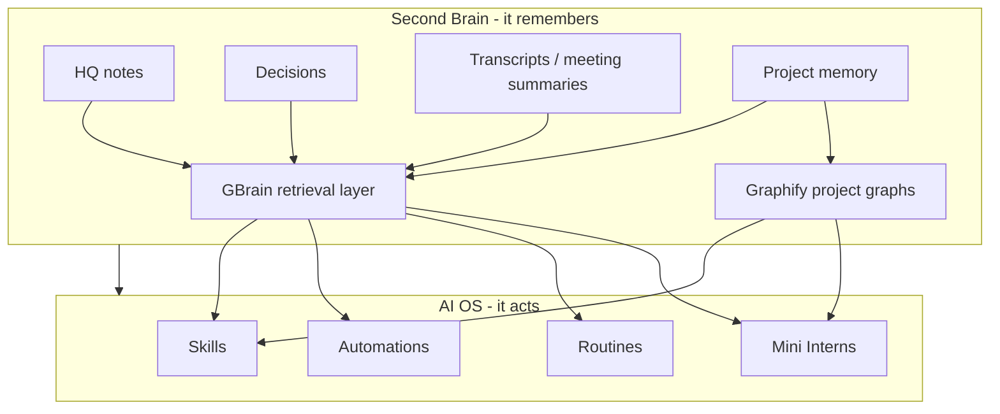

# VCOS AI OS And Second Brain Architecture

Purpose: define the two-layer VCOS HQ architecture so future agents know what remembers, what acts, and where each component belongs.

Source idea: "Two layers, one system" architecture shared by Umair on 2026-06-10. Adapted to VCOS HQ, GBrain, Skill Foundry, ClickUp, Drive, and Mini Intern operations.

## Core Model

VCOS HQ has two layers:

1. **Second Brain**: remembers.
2. **AI OS**: acts.

They are one system, but they should not be blurred.



## Four C Mapping

The Four C sequence remains the operating order.

| Layer | Four C | VCOS meaning | Primary location |
| --- | --- | --- | --- |
| Second Brain | Context | Static and durable knowledge: current state, decisions, domain interfaces, project briefs, reusable patterns | `1_Command_Brain_Core/`, `2_Domain_Packs/`, `3_Project_Workspaces/`, curated Markdown |
| Second Brain | Connections | Live or changing sources: ClickUp, Drive, GitHub, Calendar, comms, CRM-safe staging, meeting transcripts | `connections-map.md`, ClickUp/Drive/GitHub connectors, approved APIs |
| AI OS | Capabilities | Skills, SOPs, Mini Intern behaviors, deterministic scripts, agent workflows | `4_Reusable_Systems_and_Skills/`, domain READMEs, project `SKILLS_MANIFEST.md` |
| AI OS | Cadence | Scheduled or event-triggered routines that run with visibility and approval gates | `cadence-hooks.md`, `automation-registry.md`, ClickUp, future dashboard/ToolJet/mission-control |

Build in this order:

1. Context
2. Connections
3. Capabilities
4. Cadence

Do not automate before memory, source-of-truth rules, ownership, and approval gates are clear.

## Layer Responsibilities

### Second Brain Responsibilities

The Second Brain stores and retrieves what VCOS knows.

It should answer:

- What is the current focus?
- What decisions already constrain this?
- What project/domain owns this?
- What previous attempts, blockers, or lessons matter?
- What proof, claims, and approval gates exist?
- What context should an agent load next?

Second Brain components:

| Component | Role | Current tool |
| --- | --- | --- |
| Fast-path Markdown | Authoritative compact context | `AGENTS.md`, `state.md`, `active-context.md`, `key-workspaces.md` |
| Durable memory | Decisions, vocabulary, workspace anchors | `1.2_Headquarters_Memory/` |
| Project memory | Current active project context and outputs | `3_Project_Workspaces/` |
| Domain interfaces | Reusable vertical knowledge | `2_Domain_Packs/*/README.md` |
| Human visual layer | Browsing and backlinks | Obsidian opened at VCOS HQ |
| Relationship map | Project/domain/code/doc graph and lightweight GraphRAG | Graphify, local CLI, project `graphify-out/graph.json` |
| Retrieval layer | Queryable memory and synthesis candidate | GBrain, currently conservative text-first |

### AI OS Responsibilities

The AI OS performs work using the Second Brain.

It should do:

- Draft.
- Review.
- Triage.
- Route.
- Build.
- Test.
- Summarize.
- Prepare approval packets.
- Run safe routines.
- Escalate gated actions to Umair.

AI OS components:

| Component | Role | Current tool |
| --- | --- | --- |
| Skills | Packaged repeatable behavior | Skill Foundry candidates and validated skills |
| Automations | Triggered workflows | `automation-registry.md`, future n8n/Trigger.dev/Modal |
| Routines | Manual or scheduled operating loops | daily briefing, blocker sweep, approval sweep, GBrain office hours |
| Mini Interns | Role-scoped AI employees | Employee OS template and department skill packs |
| Dashboard / console | Operator surface | mission-control, future ToolJet/custom UI |

## Default Work Surface

An OS starts with a default.

For VCOS, the default work surface is:

```text
Codex / Claude / agent session
  -> HQ fast path
  -> GBrain or direct file retrieval
  -> smallest domain/project interface
  -> skill/routine only when relevant
  -> approval gate before risky action
  -> durable capture when something changes
```

The goal is not to open ten tools. The goal is to operate from HQ and let HQ route to the right tool.

## Permission Model

Prompts are not permissions.

VCOS must rely on actual access boundaries:

- Read-only keys before write keys.
- Scoped API keys before broad keys.
- Draft-only default for external communications.
- Staging tables before CRM mutation.
- Human approval before publishing, sending, spending, deleting, deploying, or final client-facing strategy/pricing.
- Separate Mini Intern credentials and context where possible.

If an agent can physically send, mutate, publish, spend, or delete, assume it eventually might. The system must block that by tool access and approval design, not only by instructions.

## Source Boundaries

| Source | Layer | Source of truth? | Notes |
| --- | --- | --- | --- |
| HQ Markdown | Second Brain | Yes for routing, decisions, protocols, and compact state | Keep concise and curated |
| GBrain | Second Brain retrieval | No, not yet | Query/index layer over approved sources; not authoritative by itself |
| Graphify | Second Brain relationship map | No | Query project/domain/repo graphs before broad file reads; generated wiki/Obsidian imports stay quarantined |
| Obsidian | Second Brain visual UI | No | Opens HQ as vault; do not duplicate memory |
| ClickUp | Connections / AI OS | Yes for task execution | First reference for AgentOSync execution |
| Drive | Connections | Yes for client files | Link from ClickUp/HQ; do not duplicate full files into memory |
| GitHub | Connections / AI OS | Yes for versioned code and PRs after setup | Keep secrets out |
| Skill Foundry | AI OS | Yes for reusable capability lifecycle | Promote after repeated value |
| AIS-OS | AI OS operating pattern | No | Supplies onboarding, Four C audit, and Three Ms level-up rhythm; do not let it become a parallel HQ |
| Dashboard / ToolJet / mission-control | AI OS operator surface | No | Shows state and triggers routines; should not become source of truth |

## Folder Mapping

```text
Second Brain
├── 1_Command_Brain_Core/1.2_Headquarters_Memory/
├── 1_Command_Brain_Core/1.1_Command_Center_State_and_Protocols/
├── 2_Domain_Packs/
├── 3_Project_Workspaces/
├── 1_Command_Brain_Core/1.3_Knowledge_Graphs/
├── Graphify project graphs over approved scopes
└── GBrain index over approved Markdown sources

AI OS
├── 4_Reusable_Systems_and_Skills/4.2_Skill_Governance_and_Candidates/
├── 4_Reusable_Systems_and_Skills/4.3_Department_Skill_Packs/
├── 4_Reusable_Systems_and_Skills/4.4_Validated_Marketplace_Skills/
├── automation-registry.md
├── cadence-hooks.md
└── future operator console
```

## Operating Loops

### Manual Loop

Use for daily project development.

1. Read fast path.
2. Ask GBrain or direct files for relevant memory.
3. Run the matching skill or office-hours review.
4. Produce an output packet.
5. Ask for approval if action is gated.
6. Capture the decision, blocker, reusable lesson, or next action.

### Skill Improvement Loop

Use after repeated workflow value or failure.

1. Run the skill.
2. Verify output.
3. Capture feedback.
4. Update the skill or candidate note.
5. Record failure mode if something broke.
6. Promote only after 3+ successful uses or clear cross-client leverage.

### Cadence Loop

Use for routines that can eventually run without being manually prompted.

1. Define trigger: manual, schedule, event, or ClickUp state.
2. Define owner.
3. Define input and output.
4. Define approval gate.
5. Test manually.
6. Add to `automation-registry.md`.
7. Automate only after repeated clean runs.

## Current Implementation State

Implemented:

- HQ fast path.
- Obsidian-as-HQ-vault pattern.
- Skill Foundry.
- Approval gates.
- Cadence hooks.
- Automation registry.
- GBrain initialized in conservative text-first mode.
- GBrain Office Hours skill candidate.
- AIS-OS cloned into the Arsenal and activated pointer-first as the weekly audit and level-up pattern.
- Graphify cloned and installed locally as the lightweight project/domain graph layer.

Not yet complete:

- Clean GBrain source design (`hq-core`, `agentosync`, `arsenal`, `amax`, `dealership`, etc.).
- First quarantined Graphify project graph and source capsule.
- Embedding provider/key strategy.
- Raw Umair voice samples for AIS-OS onboarding.
- Read-first ClickUp/Drive/GitHub connector verification.
- Operator console that shows state and triggers safe routines.
- Reliable daily cadence automation.

## Next Build Steps

1. Define clean GBrain source boundaries instead of ad hoc whole-HQ imports.
2. Configure embeddings only after credential strategy is approved.
3. Add `GBrain office hours` to daily project development flow.
4. Build the first AgentOSync Graphify project graph and add a source capsule.
5. Save the first AIS-OS style Four C audit baseline.
6. Connect ClickUp read-only first for active outcomes, blockers, and approvals.
7. Design the operator console around state panels and approved routine buttons.
8. Promote any repeated routine into Skill Foundry only after observed value.

## Non-Goals

- Do not make GBrain the system of record.
- Do not let ToolJet/mission-control become the source of truth.
- Do not connect every app at once.
- Do not automate external sends, CRM mutation, publishing, spending, destructive actions, or production deployment without explicit human approval.
- Do not treat a large context dump as a second brain. Curated memory plus retrieval discipline is the architecture.
