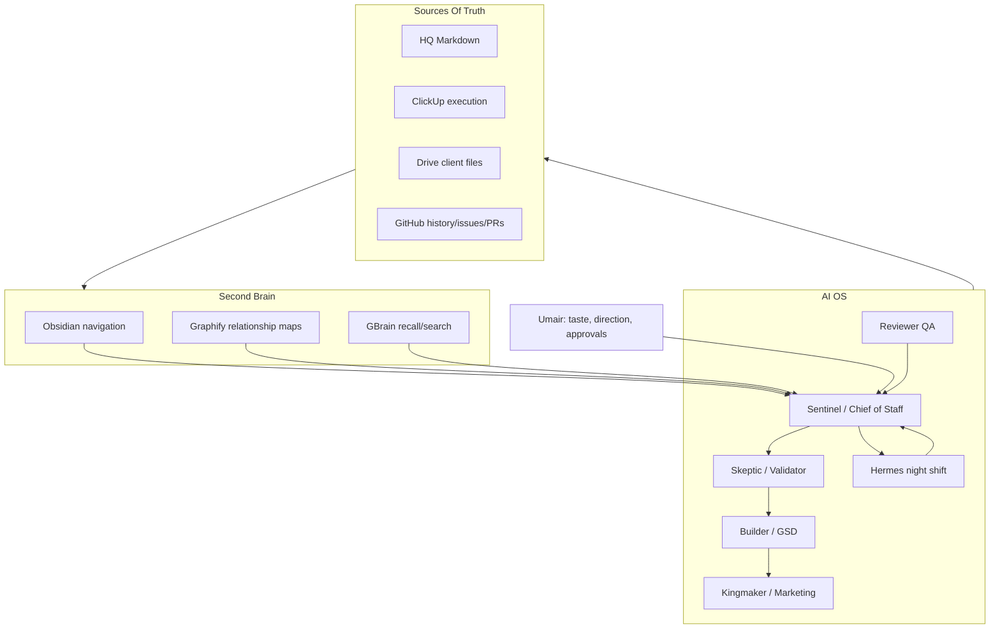

# Chief Of Staff OS Optimization

Purpose: optimize the older VCOS v4 Chief of Staff / Second Brain architecture into the current VCOS HQ stack: Obsidian, Graphify, GBrain, AIS-OS, Skill Foundry, GStack/GSD, and future Hermes night-shift execution.

Source: VCOS v4 Chief of Staff prompt shared by Umair on 2026-06-10, current VCOS HQ architecture, and the Graphify + Obsidian + light RAG protocol.

## Executive Decision

The old Chief of Staff architecture was directionally right but packaged too much into one giant agent prompt.

The optimized VCOS version should be:

```text
Principles in memory
Roles in Mini Intern packs
Relationships in Graphify
Recall in GBrain
Navigation in Obsidian
Execution in Codex / Claude / GStack / GSD
Night work in Hermes after guardrails
Truth in ClickUp, Drive, GitHub, and HQ Markdown
```

The goal is not a smarter mega-prompt. The goal is a daily operating system where agents can resume from maps, state, graphs, and handoff packets instead of rereading the whole vault.

## What To Keep From VCOS v4

| v4 element | Keep? | Optimized home |
| --- | --- | --- |
| "Taste and direction are the human's job" | Keep | `approval-gates.md`, content/domain rubrics, Reviewer QA |
| Four Gates | Keep, rename into approval/taste gates | `approval-gates.md`, `automation-registry.md`, project QA checklists |
| Digital Workforce roles | Keep, map to Mini Interns | Department skill packs and project `SKILLS_MANIFEST.md` |
| Sentinel morning brief | Keep | `cadence-hooks.md` and `automation-registry.md` |
| Kaizen diagnostics | Keep, tighten | `recursive-self-improvement-loop.md`, decisions, skill updates |
| Reusable asset > one-off deliverable | Keep | Skill Foundry and Employee OS template |
| No automation before proof | Keep | Approval gates and automation registry |
| Visceral specificity content rubric | Keep | Content domain and Marketing / Reviewer QA skills |
| Problem Intensity Formula | Keep | Skeptic / validation workflow |
| GSD build loop | Keep | Builder workflow with Graphify and source capsules |

## What To Replace

| Old pattern | Problem | New pattern |
| --- | --- | --- |
| One giant project prompt | Burns tokens and drifts | Small files + graph query + skill routing |
| Agent as "central repository" | Chat history becomes fake memory | HQ Markdown + ClickUp + Drive + GitHub are source of truth |
| "Refuse vague instructions" | Kills momentum | Clarify only when risk is high; otherwise draft conservatively |
| Always proactive agent | Can become noisy or unsafe | Cadence routines with owner, input, output, approval, and last-tested status |
| Castle map hierarchy | Too bespoke and pre-Graphify | Current numbered HQ + deep modules + knowledge graphs |
| Ralph Mode as vague autonomy | Risky | Autonomy levels with manual validation before night-shift execution |
| Airtable intervention logging by default | Adds overhead before value | Log only meaningful human corrections, approvals, failures, and reusable lessons |

## Optimized Architecture



## Daily Operating Loop

Use this when Umair logs into VCOS HQ.

1. **Start at Home / fast path.**
   - Read `AGENTS.md`, `state.md`, `active-context.md`, and `key-workspaces.md`.
2. **Ask: what mode is today?**
   - Command: priorities, blockers, approvals.
   - Build: MVP, code, implementation, demo.
   - Revenue: leads, offers, proof, sales assets.
   - Skill: reusable capability or Mini Intern improvement.
   - Learning: skill gap, office hours, critique, practice.
3. **Use the cheapest context path.**
   - Graphify query for project/domain relationships.
   - GBrain search for cross-HQ memory and prior decisions.
   - Obsidian only for human navigation.
   - Project/domain README before implementation folders.
4. **Produce one output packet.**
   - Decision packet, build plan, draft asset, review notes, task handoff, or approval request.
5. **Update only durable state.**
   - Decision, blocker, next action, source capsule, skill candidate, or ClickUp task.

## Night-Shift Hermes Loop

Hermes should not begin as a full autonomous employee. Start as a night-shift reviewer and prep agent.

### Phase 0: Read-Only Night Brief

Allowed:

- Read HQ fast path.
- Read approved project source capsules.
- Query Graphify where graphs exist.
- Query GBrain approved sources.
- Summarize Git/ClickUp state if read access is configured.
- Produce morning brief and draft next actions.

Forbidden:

- External sends.
- CRM mutation.
- Publishing.
- Spending.
- Deleting or moving files.
- Production deploys.
- Final client-facing pricing or strategy.

Output:

```markdown
# Hermes Night Brief - YYYY-MM-DD

## Completed Draft Work

## Findings

## Blockers

## Human Review Needed

## Recommended Next Actions

## Files / Tasks Touched

## Risks
```

### Phase 1: Draft-Only Work

Allowed after Phase 0 works cleanly:

- Draft PRDs, briefs, content, review packets, test plans, and implementation plans.
- Create local draft files in assigned project folders.
- Leave handoff packets.

Still forbidden:

- Anything external or destructive without approval.

### Phase 2: Supervised Internal Execution

Allowed only after repeated clean runs:

- Run tests.
- Build local demos.
- Update internal project docs.
- Prepare pull requests or ClickUp comments as drafts.

### Phase 3: Approved Routine Automation

Only promote a Hermes routine after:

- Two clean manual runs.
- One reviewed draft-only run.
- Clear input and output contract.
- Clear failure mode.
- Clear approval gate.
- Owner assigned in `automation-registry.md`.

## Optimized Four Gates

| Gate | Old name | New VCOS use | Tooling |
| --- | --- | --- | --- |
| Gate 0 | Deposit Filter | Does this belong in HQ, project, domain, skill, Arsenal, ClickUp, or Drive? | Sentinel routing |
| Gate 1 | Direction Ratification | What is the outcome and what should not happen? | fast path, project README, approval gates |
| Gate 2 | Verification / Unship | Does it work, demo, or answer the real problem? | Builder, Reviewer QA, tests, screenshots |
| Gate 3 | Taste / Publish | Would Umair attach his name to it? | Reviewer QA, human approval |

## Optimized Digital Workforce

| Old employee | New VCOS role | Primary home | Uses |
| --- | --- | --- | --- |
| Employee 04 Sentinel | Chief of Staff / router | Command Brain | daily brief, blockers, approvals, handoffs |
| Employee 03 Skeptic | Validator / reviewer | Reviewer QA + domain packs | problem intensity, market validation, risk review |
| Employee 01 Builder | GSD builder | Project workspaces | specs, code, demos, tests |
| Employee 02 Kingmaker | Marketing / proof engine | Content domain + Marketing pack | content, proof, testimonials, distribution |
| New Graph Librarian | Knowledge graph operator | `1.3_Knowledge_Graphs/` | Graphify builds, imports, source capsules |
| New Night Operator | Hermes | future runtime notes | read-only night brief, draft-only prep, supervised routines |

## Best Use Of Each Tool

| Tool | Use it for | Do not use it for |
| --- | --- | --- |
| Obsidian | Human browsing, backlinks, graph imports, visual review | Source of truth or execution |
| Graphify | Relationship maps over projects/repos/docs before broad reads | Blindly dumping generated nodes into active memory |
| GBrain | Fast text recall, office-hours critique, cross-HQ memory lookup | Replacing ClickUp/Drive/GitHub or source files |
| GStack | Office-hours critique, QA, design/eng/CEO reviews, shipping discipline | Default dependency for every small task |
| GSD | Bigger build loops with plan/todo/execute/verify | Strategy brainstorming or simple edits |
| Codex | Implementation, local file work, tests, repo hygiene | Human approval decisions |
| Claude Code | Rich planning, sub-agent build/review loops, project work | Long-term memory by chat history |
| Hermes | Nightly read/draft/summarize, later supervised routines | Unapproved external or destructive automation |

## Morning Brief Contract

Every daily start should produce:

```text
Active outcomes:
- ...

Overnight / prior-session progress:
- ...

Blockers:
- ...

Human decisions needed:
- ...

Agent-executable next actions:
- ...

Approval queue:
- ...

Best first action:
- ...
```

## First 30-Day Optimization Roadmap

### Week 1: Foundation

- Build AgentOSync Graphify graph.
- Run first Four C audit.
- Create Daily Command Brief routine.
- Keep Hermes read-only.

### Week 2: Execution

- Connect ClickUp read path.
- Create AgentOSync daily command brief from ClickUp + HQ + Graphify.
- Run GBrain office hours on one offer or build plan.
- Create one GSD build packet.

### Week 3: Skill Compounding

- Convert one repeated workflow into a skill candidate.
- Create Reviewer QA checklist for publishable assets.
- Build Dealership Employee 01 graph/source capsule.

### Week 4: Night Shift

- Run Hermes Phase 0 read-only night brief.
- Compare morning output to actual HQ state.
- Fix hallucination/failure modes.
- Only then consider draft-only work.

## Immediate Next Move

Do not start by connecting every tool.

Start with:

1. AgentOSync Graphify graph.
2. Daily Command Brief routine.
3. GBrain office-hours review of the highest-leverage AgentOSync offer/build.
4. ClickUp read-only connection.
5. Hermes read-only night brief.

This creates the compounding loop without giving the system unsafe autonomy too early.

