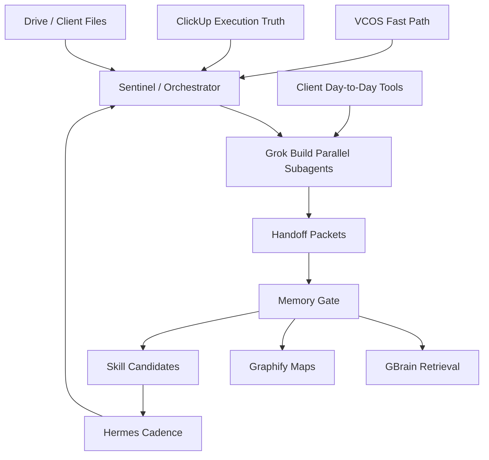

# xAI Grok Build Neural Sync Activation Plan

**Date:** 2026-06-17  
**Status:** Phase 0 plan and prompt guide. No external sends, client data mutation, deployments, spend, or production changes approved.  
**Runtime:** Grok Build CLI / `grok` and `agent`, alongside Hermes Desktop/SuperGrok, Codex, GBrain, Graphify, ClickUp, and project workspaces.  
**Goal:** Use Grok Build's coding CLI, plan mode, subagents, skills, MCP, hooks, and memory to help build the VCOS / AgentOSync Neural Sync operating system without bypassing approval gates.

## Why This Exists

Grok Build adds a coding-focused execution layer:

- plan mode for architecture before edits
- parallel subagents for research/build/review
- skills and `/skillify` for reusable workflows
- AGENTS.md / project rules support
- MCP servers and plugins
- hooks
- cross-session memory
- code search and multi-file edits
- headless mode for scripted runs
- worktree support for isolated parallel builds

VCOS already has the two-layer architecture:

- **Second Brain remembers:** HQ Markdown, GBrain, Graphify, project memory, decisions.
- **AI OS acts:** skills, routines, automations, Hermes, Codex, Grok Build, Mini Interns.

Grok Build should not become a parallel HQ. It is a builder/reviewer/subagent runtime that reads from VCOS HQ, produces handoff packets, and feeds curated learnings back into Neural Sync.

## Local Status Check

Observed locally on 2026-06-17:

```text
grok path: /Users/umairkhalid/.local/bin/grok
agent path: /Users/umairkhalid/.local/bin/agent
version: grok 0.2.54 stable
project trusted: no
```

Useful CLI flags confirmed from `grok --help`:

```text
--permission-mode plan
--experimental-memory
--worktree
--agents
--agent
--no-subagents
--check
--best-of-n
--compaction-mode segments
--compaction-detail balanced|verbose
--tools
--allow
--deny
--sandbox
```

`grok inspect` found existing VCOS/project skills, agents, plugins, MCP servers, and hooks. Because the project is not trusted yet, start with plan-mode and safe reads.

## Operating Principle

Use Grok Build for **bounded build missions**, not always-on autonomy.

Hermes owns persistent cadence and messaging.  
Grok Build owns coding/build/review bursts.  
GBrain/Graphify own memory and retrieval.  
ClickUp owns execution truth.  
Humans own approval.

## Phase Gates

### Phase 0 - Read, Map, Plan

Allowed:

- inspect repo and config
- read approved VCOS fast path
- map integrations already in use
- produce architecture plans and prompt packs
- generate proposed diffs in plan mode
- run non-destructive local checks
- write draft docs inside VCOS HQ

Not allowed:

- install new external integrations
- mutate ClickUp, CRM, Drive, QuickBooks, WhatsApp, Telegram, Slack, client systems, databases, or production repos
- deploy
- publish
- spend
- send external messages
- store raw client data in durable memory

### Phase 1 - Internal Build Drafts

Allowed after review:

- create local scaffolds
- build prototype dashboards or routers using mock/sanitized data
- create MCP config drafts
- create skills/plugin bundles in staging folders
- run tests
- produce handoff packets

### Phase 2 - Approved Integrations

Requires explicit approval per integration:

- ClickUp read connector
- Google Drive read connector
- GitHub private repo setup
- QuickBooks sandbox read
- ToolJet local/staging
- Telegram/Slack approval surface
- n8n/Trigger.dev worker
- Postgres/Supabase staging DB

### Phase 3 - Client-Facing / Production

Human-only approval before:

- external messages
- CRM/accounting mutation
- production deploys
- public assets
- pricing/proposals
- spend
- deletion/destructive workflows

## Neural Sync Hive Architecture

The "hive" is a set of role-scoped agents feeding one curated memory loop.



## Core Subagents

Start with seven. Add more only after outputs are consistently useful.

| Subagent | Ownership | Reads | Produces |
| --- | --- | --- | --- |
| Sentinel | routing, gates, task ownership | fast path, state, active-context, key-workspaces | mission brief, approval map, handoff packet |
| Integration Mapper | client tool inventory | project READMEs, source pointers, ClickUp/Drive notes | integration cards, source-of-truth map |
| Workflow Archaeologist | day-to-day process extraction | domain/project docs, SOPs, client notes | workflow maps, bottlenecks, "human approval" points |
| Schema Architect | data contracts | forms, ledgers, QB/CRM exports, dashboard specs | canonical objects, fields, event/state model |
| Builder | implementation drafts | approved specs and mock data | prototype scaffolds, scripts, MCP config drafts |
| Skeptic | adversarial review | all outputs | risks, missing tests, gate violations, hallucination checks |
| Memory Curator | recursive learning | handoffs, decisions, errors, wins | memory updates, skill candidates, prevention rules |

## Integration Inventory Targets

Map tools our clients or lanes already touch day to day:

| Lane | Day-to-day tools | Neural Sync use |
| --- | --- | --- |
| VCOS HQ | Markdown, Obsidian, GBrain, Graphify, ClickUp | command memory, routing, source-of-truth control |
| AgentOSync | ClickUp, Drive, GitHub, demos, lead/proof assets | task orchestration, proof pipeline, Mini Intern packaging |
| AMAX Travel | QuickBooks, Systrix, ToolJet, Postgres, WhatsApp, ClickUp, Drive | CFO cleanup, finance exceptions, 9-room dashboard, distribution handoffs |
| Dealership OS | CRM/exported leads, missed-call workflows, Vapi/AVAPI, ClickUp, demos | Employee 01 Front Desk proof, lead recovery, owner morning brief |
| Trading Coach | Hermes, x_search, DeepCharts screenshots, Markdown logs | coach-only discipline, prep, review, feedback loop |
| Content Intel | X/LinkedIn/manual voice examples, ClickUp, Drive | signals to draft content, but only after voice calibration |

## Memory Loop

Every Grok Build mission must output a handoff packet:

```text
Mission:
Date:
Runtime:
Session ID / command:
Inputs read:
Files changed:
Facts learned:
Decisions needed:
Blockers:
Risks:
Reusable pattern:
Should update memory: yes/no
Should create skill candidate: yes/no
Next action:
Approval needed:
```

Only promote curated facts into durable memory:

- decisions
- blockers
- source-of-truth links
- schemas
- workflows
- repeated failures
- reusable wins
- approved prompt patterns

Do not promote:

- raw logs
- raw client data
- secrets
- noisy terminal output
- full transcripts
- private customer records

## Step-by-Step Activation

### Step 1 - Verify Grok Build

Run:

```bash
~/.local/bin/grok --version
~/.local/bin/grok inspect
~/.local/bin/grok memory --help
~/.local/bin/grok mcp --help
~/.local/bin/grok plugin --help
```

Expected:

- Grok installed.
- VCOS instructions detected.
- Project trust status visible.
- Memory/MCP/plugin commands available.

### Step 2 - Start In Plan Mode

Use plan mode for every first run in a project:

```bash
~/.local/bin/grok \
  --permission-mode plan \
  --experimental-memory \
  --compaction-mode segments \
  --compaction-detail balanced
```

Paste the mission prompt from the next section.

### Step 3 - First Mission: Neural Sync Integration Map

Prompt:

```text
You are Grok Build operating inside VCOS HQ.

Mission: create a Phase 0 integration map for the Neural Sync operating system.

Rules:
- Read the VCOS fast path first.
- Use progressive context loading.
- Do not mutate external systems.
- Do not install anything.
- Do not access client secrets.
- Do not write code yet.
- Produce a plan first.
- Keep raw outputs out of durable memory.

Read only:
1_Command_Brain_Core/1.2_Headquarters_Memory/ubiquitous_language.md
1_Command_Brain_Core/1.1_Command_Center_State_and_Protocols/state.md
1_Command_Brain_Core/1.2_Headquarters_Memory/active-context.md
1_Command_Brain_Core/1.2_Headquarters_Memory/key-workspaces.md
1_Command_Brain_Core/1.1_Command_Center_State_and_Protocols/ai-os-second-brain-architecture.md
1_Command_Brain_Core/1.1_Command_Center_State_and_Protocols/hermes-supergrok-vcos-playbook.md
1_Command_Brain_Core/1.1_Command_Center_State_and_Protocols/managed-agent-runtime-evaluation.md

Then inspect only the README.md files for:
3_Project_Workspaces/3.7_AMAX_Travel_Operating_System/
3_Project_Workspaces/3.6_Sameer_Uzair_Dealership_Operating_System/
3_Project_Workspaces/3.4_Workplace_AI_Trading_Coach/
3_Project_Workspaces/3.1_AgentOSync_Revenue_Pipeline/

Output:
1. Current Neural Sync architecture.
2. Integrations already implied by our clients' daily tools.
3. What should be read-only first.
4. What is approval-gated.
5. A proposed subagent plan.
6. A memory loop.
7. The first 3 build artifacts we should create.
8. Risks and open questions.

Do not edit files until I approve the plan.
```

### Step 4 - Spawn Parallel Research Subagents

Use Grok Build's natural subagent delegation from plan mode. Prompt:

```text
Spawn parallel subagents, each with isolated context and no write permission unless I approve later:

1. Integration Mapper:
Map all day-to-day tools across AMAX, Dealership OS, Trading Coach, AgentOSync GTM, and Content Intel. Output source-of-truth, read/write risks, and first safe read-only workflow.

2. Memory Architect:
Design the recursive memory loop: what goes to Markdown, what goes to GBrain, what goes to Graphify, what becomes a skill candidate, and what must never be stored.

3. Workflow Builder:
Design the first local Neural Sync prototype using mock data only: inputs, state store, worker layer, handoff packet, approval gate, and dashboard/output.

4. Skeptic:
Attack the plan. Find security, privacy, hallucination, cost, approval, and context-rot risks.

5. Demo Designer:
Turn the first prototype into a 5-minute demo for a client or teammate, with no external sends or real client mutation.

Each subagent must return:
- sources read
- key findings
- recommended action
- approval gates
- memory update candidates
- confidence level
```

### Step 5 - Consolidate Into A Hive Handoff

Prompt:

```text
Consolidate all subagent outputs into one Neural Sync Hive Handoff.

Format:
Bottom line:
What we can build now:
What must remain draft-only:
Integration map:
Memory map:
First prototype:
Subagent findings:
Skeptic findings:
Open decisions:
Next 5 actions:
What should be saved to VCOS memory:
What should not be saved:
```

### Step 6 - Build Only After Approval

After plan approval, use:

```bash
~/.local/bin/grok \
  --permission-mode plan \
  --experimental-memory \
  --worktree neural-sync-prototype \
  --check
```

Build prompt:

```text
Approved mission: create a local-only Neural Sync prototype scaffold.

Constraints:
- mock data only
- no external APIs
- no client PII
- no CRM/accounting/ClickUp/Drive mutation
- no deployment
- no secrets

Build artifacts:
1. /private/tmp or approved project workspace prototype folder.
2. README explaining architecture.
3. mock integration cards for AMAX, Dealership OS, Trading Coach, AgentOSync.
4. handoff packet template.
5. recursive memory update template.
6. sample dashboard/state JSON.
7. verification checklist.

Before editing, show the file plan and wait for approval.
```

### Step 7 - Review With Skeptic

Prompt:

```text
Run a Skeptic review of the Neural Sync prototype.

Prioritize:
- privacy leaks
- accidental write/mutation paths
- hallucinated integrations
- unclear source of truth
- missing approval gate
- bad memory promotion
- brittle architecture
- scope creep
- unclear demo story

Output findings by severity with exact file references.
```

### Step 8 - Convert To Skill Candidate

Only after 3 clean uses:

```text
Review the last 3 Neural Sync setup/build runs.

Create a skill candidate only if:
- the workflow repeated
- it reduced context load
- it avoided mistakes
- it has clear trigger/input/output
- it has approval gates
- it can be tested

Draft the SKILL.md, but do not install/promote it yet.
```

## Prompt Pack

### Prompt A - Morning Builder Standup

```text
You are Grok Build working as VCOS Builder.

Read the fast path. Then produce today's build standup:
- active lane
- highest leverage build target
- files to read next
- subagents needed
- approval gates
- expected artifact by end of session

Do not edit. Plan only.
```

### Prompt B - Integration Card Generator

```text
Create integration cards for this client/workflow.

For each tool:
- tool name
- user/team uses it for
- source of truth status
- read-safe data
- write/mutation risk
- credentials needed
- first Phase 0 use
- Phase 1 use
- human approval gate
- failure mode
- sample handoff packet fields

Use no raw client data.
```

### Prompt C - Hive Subagent Brief

```text
You are a subagent in the Neural Sync hive.

Your assigned role:
[ROLE]

You may read only:
[FILES/PATHS]

You must not:
- mutate external systems
- install packages
- use secrets
- store raw client data
- make final client claims

Return:
1. Findings.
2. Evidence/source paths.
3. Risks.
4. Recommended next action.
5. Memory update candidates.
6. Confidence.
```

### Prompt D - Memory Curator

```text
Curate this session into durable VCOS memory.

Promote only:
- decisions
- blockers
- integration maps
- approved source-of-truth rules
- reusable prompt patterns
- prevention rules
- skill candidates

Do not promote:
- raw logs
- secrets
- raw client data
- long transcripts
- speculative claims

Output:
1. Add to state.md? yes/no + exact bullet.
2. Add to decisions.md? yes/no + exact bullet.
3. Add to project README? yes/no + exact bullet.
4. Add skill candidate? yes/no + trigger/input/output.
5. No-save list.
```

### Prompt E - Client Toolchain Opportunity Scanner

```text
Map how Neural Sync can help this client using tools they already touch daily.

Client/lane:
[AMAX / Dealership / Trading Coach / AgentOSync / Content Intel]

Known tools:
[paste]

Find:
1. Highest-friction daily workflow.
2. Inputs already available.
3. Existing source of truth.
4. Human approval point.
5. First safe read-only agent task.
6. First demo artifact.
7. What would make it obviously valuable in 5 minutes.
8. What must not be automated yet.
```

### Prompt F - Recursive Self-Improvement Review

```text
Review the last run.

Did the agent:
- load too much context?
- miss a fast-path rule?
- invent an integration?
- propose a gated action without approval?
- create reusable value?
- reduce future work?

Return:
1. What worked.
2. What failed.
3. Root cause.
4. Prevention rule.
5. Skill/memory update.
6. Re-test prompt.
```

## First Three Build Artifacts

Create these before any live integration:

1. **Neural Sync Integration Registry**
   - local Markdown or JSON registry of tool cards by lane
   - no credentials
   - read/write/gate fields

2. **Hive Handoff Packet Template**
   - standard output every subagent returns
   - source paths, facts, decisions, blockers, memory candidates

3. **Mock Neural Sync Mission Control**
   - local-only dashboard/state file
   - shows active lanes, blockers, approvals, suggested next actions
   - no live ClickUp/CRM mutation

## First Suggested Grok Build Session

Run:

```bash
~/.local/bin/grok \
  --permission-mode plan \
  --experimental-memory \
  --compaction-mode segments \
  --compaction-detail balanced
```

Paste:

```text
We are activating Grok Build as the coding/build subagent layer for VCOS Neural Sync.

Use this plan:
1_Command_Brain_Core/1.1_Command_Center_State_and_Protocols/xai-grok-build-neural-sync-activation-plan.md

Your first job is not to build. Your first job is to produce a plan for the first local-only Neural Sync Integration Registry.

Rules:
- read fast path first
- no external mutation
- no installs
- no secrets
- no raw client data
- plan mode only
- output exact file plan and wait for approval

Propose:
1. file paths
2. schema
3. sample cards for AMAX, Dealership OS, Trading Coach
4. verification checklist
5. how outputs feed GBrain/Graphify/Hermes later
```

## What "Max Capability" Means

Max capability is not "let every agent touch everything."

Max capability means:

- least-privilege connectors
- source-of-truth clarity
- fast manual proof loops
- subagents with isolated scopes
- deterministic handoff packets
- recursive memory without raw noise
- one approval surface
- one operator dashboard
- repeatable skill promotion
- demo artifacts that map to real client pain

## Immediate Next Action

Run the first Grok Build session in plan mode and ask it to design the Neural Sync Integration Registry. Do not let it edit until the plan is reviewed.

After the first plan:

1. Save the plan as a handoff packet.
2. Have Skeptic review it.
3. Approve only the local/mock artifact.
4. Build the registry.
5. Feed curated findings into GBrain/Graphify.
6. Repeat with AMAX, Dealership OS, and Trading Coach.
