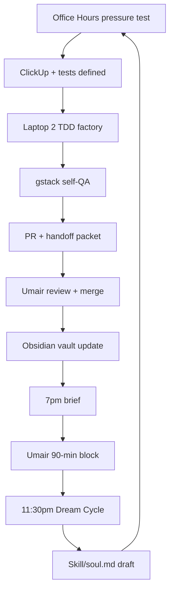
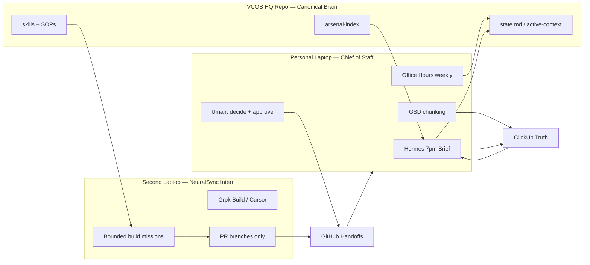

# Dual-Laptop Hermes Activation Plan

**Date:** 2026-06-19  
**Status:** **Approved** — Interactive OH 2026-06-19 game plan locked  
**Purpose:** Structured activation plan for Personal Laptop Chief-of-Staff Hermes (7pm daily brief + WhatsApp) and Second Laptop NeuralSync Intern (24/7 + Telegram). Week 1 = **Mission Control dashboard** + GitHub coordination between two Hermes cubicles.

**Interactive OH (final):** `session-briefs/interactive-office-hours-dual-laptop-hermes-2026-06-19.md`  
**GBrain critique:** `session-briefs/gbrain-office-hours-dual-laptop-hermes-2026-06-19.md`  
**ClickUp payloads:** `session-briefs/clickup-payloads-dual-laptop-hermes-2026-06-19.md`  
**ClickUp list:** https://app.clickup.com/9017760195/v/li/901713786845  
**Mission Control:** `1_Command_Brain_Core/1.1_Command_Center_State_and_Protocols/mission-control/`

**Fast path router:** `1_Command_Brain_Core/1.1_Command_Center_State_and_Protocols/session-briefs/README.md`

**Related HQ files:**
- `1_Command_Brain_Core/1.1_Command_Center_State_and_Protocols/hermes-supergrok-vcos-playbook.md`
- `1_Command_Brain_Core/1.1_Command_Center_State_and_Protocols/hermes-vcos-first-seed-brief-2026-06-13.md`
- `1_Command_Brain_Core/1.1_Command_Center_State_and_Protocols/xai-grok-build-neural-sync-activation-plan.md`
- `1_Command_Brain_Core/1.1_Command_Center_State_and_Protocols/cadence-hooks.md`
- `1_Command_Brain_Core/1.1_Command_Center_State_and_Protocols/recursive-self-improvement-loop.md`
- `1_Command_Brain_Core/1.1_Command_Center_State_and_Protocols/approval-gates.md`
- `1_Command_Brain_Core/1.1_Command_Center_State_and_Protocols/obsidian-second-brain.md`
- `1_Command_Brain_Core/1.1_Command_Center_State_and_Protocols/ai-os-second-brain-architecture.md`
- `6_Arsenal/arsenal-index.md`

**ClickUp rule:** AgentOSync work starts at https://app.clickup.com/9017760195/v/s/90175689274 and main async folders 90178817003 / 90178817004.

---

## Executive Summary

Build a two-device operating system:

| Device | Role | Primary runtime | Cadence |
| --- | --- | --- | --- |
| Personal laptop | Chief of Staff | Hermes Desktop + SuperGrok | 7:00 PM daily work-start brief |
| Second laptop | Builder Intern | Grok Build + Cursor | 24/7 bounded missions (idle when no queue) |
| VCOS HQ repo | Canonical brain | Markdown + Git | Always — both devices pull from here |
| ClickUp | Execution truth | Tasks, due dates, blockers | Daily + weekly office hours |

**Core workflow rule:** Prove on personal laptop → encode in HQ → push Git → intern pulls → PR back → human reviews → promote.

**North star:** Ship validated outcomes faster with less cognitive load, while compounding reusable systems. Not "replicate yourself" — build a **delegation ladder** inside a **closed-loop flywheel**: sense → decide → build → test → ship → learn → rewrite skills → repeat.

**Crucial first step (non-negotiable):** Manually prove the 7pm VCOS brief and one end-to-end TDD intern task before adding departments, swarms, or publishing automation. Once the loop saves measurable time, Hermes promotes it to a skill; compounding begins.

---

## YC Closed-Loop Critique (Integrated)

This section pressure-tests the original dual-laptop plan against YC-style AI-native company patterns. Each item maps to a concrete change in this plan and a VCOS approval gate.

### 1. Software Factory, Not Just Code Generation

**YC insight:** High-velocity AI companies run **software factories** — spec + tests define success; the builder iterates until green, then adversarial QA runs before any human PR review.

**Gap in v1 plan:** Laptop 2 picked up PRDs and pushed code without mandatory test contracts or self-QA.

**Fix — TDD Intern Contract (required for every `intern-ready` task):**

```text
INTERN-READY TASK MUST INCLUDE:
1. Spec (what / why / out of scope)
2. Acceptance criteria (human-readable)
3. Test contract (exact commands + expected pass/fail)
4. QA layer (gstack /qa or Playwright browse — intern runs before PR)
5. Skeptic review packet (risks, gate violations)
6. Handoff packet (always)
```

**Factory loop:**

```text
Office Hours survives → ClickUp task created → tests defined first
    → Intern iterates until tests pass → self-QA (browse/Playwright)
    → Skeptic subagent → PR to Umair → merge → skill harvest
```

**Arsenal alignment:** GStack (`/qa`, `/review`, browse daemon), Grok Build `--check`, `pr-babysit` for CI.

### 2. Dream Cycle (Nightly Recursive Self-Improvement)

**YC insight:** Background "dream" agents read daily transcripts/logs, grade skills, prune overlap, and rewrite playbooks — not just a Saturday log.

**Gap in v1 plan:** Recursive improvement was weekly-only.

**Fix — Nightly Dream Cycle cron (Laptop 1, Phase 1+):**

| Time | Profile | Job |
| --- | --- | --- |
| 11:30 PM America/Toronto | VCOS-Librarian or Brain | Read day's Hermes sessions, PR handoffs, brief scores, failures |
| Output | — | Dream Cycle packet (see template below) |
| Write | — | Proposed `skills.md` / soul.md / HQ updates — **draft only** |
| Promote | — | Umair approves before any durable memory write |

**Dream Cycle packet template:**

```text
## Dream Cycle — [DATE]

Sessions reviewed: __
Brief score today: __/5
PRs / missions today: __

What worked (promote):
- ...

What failed (root cause category per recursive-self-improvement-loop.md):
- ...

Skills to merge/prune (DRY + MECE check):
- Keep: ...
- Merge: ...
- Kill: ...

Proposed soul.md / skill updates (DRAFT — human approves):
- ...

Tomorrow's prevention rules:
- ...

Re-test prompt for weakest loop:
- ...
```

**Hermes native loop:** Hermes synthesizes repeated solutions into reusable skill files. Nightly Dream Cycle curates what gets promoted — raw logs never go to durable memory.

### 3. Mission Integrity (Hos + Integrity = Incorruptible)

**YC insight:** Scale without structural integrity causes mission drift. Embed ethos in every automated action.

**VCOS interpretation (practical now, legal entity later):**

| Layer | Action | When |
| --- | --- | --- |
| `soul.md` | Mission, non-negotiables, revenue-first, approval gates, ubiquitous language | Day 1 seed |
| `decisions.md` | Every phase advance + client boundary | Ongoing |
| PBC / legal structure | Public Benefit Corporation to protect mission | **Parking lot** — evaluate after first paid pilot; not a Week 1 blocker |
| Automated proposals | Every intern PR + content draft includes "mission alignment" line | Phase 2+ |

**soul.md must include:** VCOS HQ is brain; ClickUp is truth; draft-only default; no external send without approval; revenue lanes in priority order from `active-context.md`.

### 4. Trust-by-Default Visibility (Audit the Messy Middle)

**YC insight:** Default to transparent agent journeys — prompts, tool calls, failures — so you fix the exact instruction, not guess.

**Gap in v1 plan:** Intern was isolated; failure diagnosis was underspecified.

**Fix — Mission Control visibility stack:**

| Artifact | Location | Purpose |
| --- | --- | --- |
| Hermes Desktop sessions + artifacts | `~/.hermes/` + Desktop UI | Prompt/tool journey per task |
| Handoff packets | `session-briefs/handoffs/` | Cross-device continuity |
| Dream Cycle logs | `session-briefs/dream-cycles/` | Nightly learning draft (create folder on first run) |
| Intern mission logs | ClickUp draft comment + PR description | Audit trail |
| Token/cost telemetry | CodeBurn (Arsenal) | Spend visibility |
| QA evidence | gstack browse screenshots | Pre-PR bug proof |

**Rule:** Every failed mission must answer: *which step, which prompt line, which missing test* — not "the agent was wrong."

**Evaluate later (not Week 1):** Paperclip (org chart + token budgets per agent), Labyrinth-style journey maps — add to Arsenal as `untested` if adopted.

---

## Elite Foundation Blueprint (YC-Aligned Phases)

These phases sit **on top of** the original Phase 0–3 gates. Do not skip gates.

### Elite Phase 1: Private Denormalized Brain (Context Engine)

**Goal:** Entire company legible and queryable to AI — locally, privately.

| Component | VCOS implementation | Status |
| --- | --- | --- |
| **The Vault** | Obsidian on `_VCOS_Headquarters` (see `obsidian-second-brain.md`) | Activated 2026-06-10 |
| **Continuous capture** | Denormalize ClickUp summaries, meeting transcripts (Meetily), P&L pointers, customer feedback into vault via capture flow — not raw dumps | Build pipeline Week 2–4 |
| **Retrieval** | GBrain + QMD + Graphify pointer-first over approved collections | Arsenal evaluation |
| **Sensitive data** | Ollama local models (Qwen/Llama) for PII-heavy scans on Laptop 1; cloud models for non-sensitive reasoning | Evaluate after brief loop proven |
| **Private network** | Tailscale mesh between Laptop 1 and Laptop 2 — no public exposure of intern | Before Laptop 2 Phase 2 |

**Capture flow (unchanged discipline):** Raw → distill → promote durable facts only. See `obsidian-second-brain.md`.

### Elite Phase 2: Laptop 1 — Strategist & Orchestrator (Token Maxing)

**Goal:** Thin harness, fat skills. CEO layer refuses bad work before it hits the intern.

| Practice | Implementation |
| --- | --- |
| **Thin harness, fat skills** | Hermes profiles stay few; skills grow in `4_Reusable_Systems_and_Skills/` after 3+ validations |
| **Office Hours forcing function** | **No `intern-ready` tag** until gstack `/office-hours` pressure test passes on the idea ("strongest evidence someone wants this?") |
| **7pm brief** | Pull from Obsidian vault + ClickUp + weekly OH plan + GSD chunks + Dream Cycle prevention rules |
| **WhatsApp gateway** | Phase 1+ only; approved template; compressed 3 chunks + 1 blocker + 90-min focus |

**Office Hours → Intern gate:**

```text
Idea → /office-hours pressure test → survives?
  NO  → parking lot
  YES → ClickUp task + acceptance criteria + tests → intern-ready tag
```

### Elite Phase 3: Laptop 2 — 24/7 Builder & Publisher (Bounded Factory)

**Goal:** Parallel execution with tests and self-QA — not autonomous chaos.

| Capability | Tool | Gate |
| --- | --- | --- |
| **Parallel build** | Hermes sub-agents / Grok Build `--agents` — backend + frontend + test agent | One mission = one worktree |
| **TDD loop** | Tests defined in ClickUp; intern iterates until green | Required |
| **Self-QA** | gstack `/qa` or browse Playwright before PR | Required |
| **Content research** | NotebookLM via MCP (evaluate; add to Arsenal) | Draft-only |
| **Video/assets** | Hyperframes skill candidate (already in `4.2`) | No public publish without Gate 2 |
| **SEO deploy** | Netlify staging only | Gate 2 + Gate 4 for production |
| **Social push** | Never autonomous in Phase 2–3 | Gate 1 + Gate 3 always |

**Content flywheel (approval-gated):** Market research → draft article/podcast script → Hyperframes/video packet → **Umair approves** → publish. Intern prepares; human ships.

### Elite Phase 4: Virtual Company Layer (After Dual-Laptop Stable)

**Do not start until:** 3 green weekly scorecards + 3 merged TDD PRs + nightly Dream Cycle running 14 nights.

| Component | Purpose | VCOS home |
| --- | --- | --- |
| **Paperclip** (evaluate) | Org chart, ticketing, per-agent token budgets | Arsenal candidate — untested |
| **Department profiles** | Sales (Apify scrape + draft outreach), CS (email monitor), Marketing (content orchestration) | `4.3_Department_Skill_Packs/` |
| **Nightly flywheel** | Dream Cycle + skill DRY/MECE prune + playbook rewrite | `session-briefs/dream-cycles/` |
| **Recursive loop** | Sensor → policy → tools → QA → output → feedback → learning → re-test | `recursive-self-improvement-loop.md` |

**Department spin-up order (after factory stable):**
1. Reviewer/QA (Skeptic) — already required
2. Builder (intern) — already planned
3. Marketing drafts — after voice calibration
4. Sales research — after first paid pilot language exists
5. CS — after live client with approval surfaces

---

## Closed-Loop Flywheel (Target State)



---

## Interactive OH Game Plan (Approved 2026-06-19)

**Week 1 north star:** Dual-Hermes **Mission Control** — two cubicles (L1 WhatsApp, L2 Telegram), GitHub coordination bus, visible overnight work + easy decision relay.

**Must-ship metric:** 7pm brief loop — 7/7 delivery, avg ≥3.5 (brief previously failed all quality checks).

**First L2 mission:** VCOS HQ handoff sync (not greenfield features).

**100 parallel subagents:** North star Week 4+ — not Week 1 exit criteria.

Full session: `session-briefs/interactive-office-hours-dual-laptop-hermes-2026-06-19.md`

---

## Locked Decisions (Interactive OH)

| # | Decision | Locked |
| --- | --- | --- |
| 1 | Week 1 core | Mission Control + dual Hermes via GitHub |
| 2 | L1 channel | WhatsApp (active) |
| 3 | L2 channel | Telegram bot (activate Week 1) |
| 4 | 7pm brief | Locked template below + cron |
| 5 | Dream Cycle | Before sleep (lite) |
| 6 | 8am heartbeat | After 5 nights brief ≥3.5 |
| 7 | L2 first mission | VCOS HQ sync/handoffs |
| 8 | Client format | Dealership ¶ (3 bullets) + AMAX ¶ (3 bullets) chronological |
| 9 | ClickUp home | List `901713786845` |
| 10 | Parking lot | Ollama, Paperclip, NotebookLM, auto-publish |

---

## Locked 7pm Brief Template

```text
## 7PM Work-Start Brief — [DATE]

### OS / Flywheel Health
- Brief score yesterday: __/5 | Delegation level: L__
- L2 last push: [branch/PR/time] | L1 local commits today: __

### Overnight — Laptop 2 (NeuralSync Intern)
- What it worked on: __
- GitHub: [branch / PR link / files touched]
- Decisions needed from you: __

### Today — Laptop 1 (Chief of Staff)
- Local sessions / repos touched: __
- Artifacts worth reviewing: __

### Dealership OS (3 bullets max)
- __
- __
- __

### AMAX (3 bullets max)
- __
- __
- __

### 90-Min Chunk Tonight
- Lane: __ | Task: __ | Done means: __

### Parking Lot (do NOT work on)
- __
```

Update `mission-control/state.json` after each brief.

---

## Parking Lot (Post-OH)

Still deferred:

- 100 parallel subagent swarms (Week 4+)
- 8am heartbeat (until brief proven)
- NotebookLM, Paperclip, Ollama, public auto-publish
- VPS 24/7 Hermes (Desktop + L2 first)
- Elite Phase 4 virtual company

---

## Office Hours Pressure Test

Run these six questions during the review session. Edit this plan based on answers. **Completed 2026-06-19** — see GBrain packet for full answers.

### 1. Demand Reality

What problem does this solve that is painful *today*?

- Context reload every evening: "What should I work on tonight?"
- ClickUp tasks, weekly office hours outcomes, and GSD chunks are not fused into one brief.
- Second laptop sits idle or is used ad hoc without a mission queue.
- Arsenal gems accumulate without one-by-one validation.

**Danger:** Building two autonomous agents before one closed loop (7pm brief) proves value.

### 2. Status Quo That Must Change

- Hermes playbook exists but 7pm cron may not be live or scored.
- Weekly office hours produces outcomes but daily GSD chunking may not feed the brief.
- Arsenal index has many `cloned-evaluation` / `untested` entries — no weekly promotion rhythm.
- Second laptop vision (24/7 intern) risks running ahead of personal-laptop proof.

### 3. Desperate Specificity

Who must observe what by when?

| Observer | Observable outcome | Deadline |
| --- | --- | --- |
| Umair | 7pm brief is useful (avg ≥3.5/5) | End of Week 2 |
| Umair | Weekly outcomes visible in brief with % progress | End of Week 2 |
| Umair | One Arsenal gem tested and status updated | End of Week 1 |
| Umair | First `intern-ready` ClickUp task completed via PR | End of Week 4 |
| Market/stakeholder | One revenue lane ships observable artifact | Per active-context priorities |

### 4. Narrowest Wedge

Do not launch full dual-laptop autonomy in Week 1.

**Week 1 wedge only:**
1. Personal Hermes manual 7pm brief (ClickUp paste + weekly plan file).
2. Score it. Fix prompt. Schedule cron.
3. Test one Arsenal gem (CodeBurn or GBrain).

**Defer until wedge proves:**
- WhatsApp delivery (Phase 1+)
- Second laptop 24/7 queue
- ClickUp write automation
- Opportunity scanner cron

### 5. Observation Required

By next Sunday office hours, record:

- Brief delivery count: __/7
- Brief usefulness avg: __/5
- ClickUp tasks with due date + status: __%
- Arsenal gem tested this week: yes/no — which: __
- Second laptop provisioned: yes/no (should be no in Week 1)
- One thing killed from scope: __

### 6. Future Fit

This plan fits the 12-month VCOS direction if it produces reusable operating chunks:

- 7pm brief template → reusable Chief-of-Staff cron skill
- Weekly office hours → ClickUp subtasks → GSD chunks → brief pipeline
- Arsenal one-by-one → skill promotion loop
- Intern mission queue → NeuralSync employee template pattern
- Handoff packets → cross-device continuity without chat history

---

## First-Principles Architecture

### What each layer owns

```text
VCOS HQ repo     → remembers (state, decisions, SOPs, skills)
ClickUp          → execution truth (tasks, due dates, owners, blockers)
GitHub           → code handoffs (feature branches, PRs, never silent main merges)
Personal Hermes  → sense, summarize, route, remind, draft (Chief of Staff)
Laptop 2 Intern  → bounded build missions in worktrees (Builder)
Umair            → approve, decide, merge, send (Human gates)
```

### System diagram



### Anti-patterns (kill early)

| Anti-pattern | Why it fails | Prevention |
| --- | --- | --- |
| Two `~/.hermes/` memories as source of truth | Drift, conflicting priorities | HQ repo is canonical; device memory is cache |
| 24/7 intern without `intern-ready` tag | Runaway scope, bad PRs | No tag = no work |
| WhatsApp before brief quality proven | Gate 1 violation, embarrassment risk | Phase 0: Desktop/artifacts only |
| Parallel Arsenal testing | Context rot, no compounding | One gem per week max |
| Laptop 2 before personal proof | Automating broken workflows | Prove → encode → delegate |

---

## Quantifiable North-Star Metrics

Track weekly in Sunday office hours scorecard.

### Tier 1 — Operating System Health

| Metric | Week 2 target | Week 4 target | Week 12 target |
| --- | --- | --- | --- |
| 7pm brief delivery rate | 5/7 days | 7/7 days | 7/7 days |
| Brief usefulness (Umair 1–5) | avg ≥ 3.5 | avg ≥ 4.0 | avg ≥ 4.2 |
| ClickUp tasks with due date + status | 70% | 80% | 95% |
| Weekly OH → ClickUp subtasks created | 100% | 100% | 100% |
| Handoff packets per week | 2+ | 3+ | 10+ |
| Arsenal gems promoted | 0–1 | 1 | 1/month |

### Tier 2 — Delegation Depth

| Metric | Week 4 | Week 8 | Week 12 |
| --- | --- | --- | --- |
| % of daily brief auto-generated | 30% | 60% | 80% |
| Intern missions/week (unsupervised) | 0 | 1–2 | 3+ |
| PRs from Laptop 2 (review only) | 0 | 1–2 | 3+/week |
| Hours from weekly outcome → first GSD subtask | < 48h | < 24h | < 12h |

### Tier 3 — Market Validation

Tied to `active-context.md` priority order (update when priorities shift):

| Lane | Observable signal | Source |
| --- | --- | --- |
| Dealership OS | Owner rehearses 4-min flow without agent | Office hours outcome |
| AMAX finance | CFO/Maaz explicit yes/revise on policy items | ClickUp comment |
| Content-intel | Voice files exist OR blocker reclassified | voice-calibration folder |
| AgentOSync GTM | Shipped proof artifact + feedback signal | GitHub / Drive / meeting booked |

### Weekly scorecard template

```text
Week ending: ____

Brief reliability:        __/7
Brief usefulness avg:     __/5
ClickUp hygiene:          __%
Weekly outcomes shipped:  __/3
Delegation events:        __ (Laptop 2 work without Umair authoring)
Market signals:           __
Arsenal gem tested:       __ (status: __)
One thing to kill:        __
One thing to promote:     __
Delegation ladder level:  L__
```

---

## Phase Gates

Aligned with `hermes-supergrok-vcos-playbook.md` and `approval-gates.md`.

### Phase 0 — Personal Hermes Sensor (Week 1–2)

**Allowed:**
- Read approved HQ files and user-pasted ClickUp summaries
- Scoped local folder scan (allowlist only)
- Draft briefs to Desktop / artifacts
- Manual runs and cron to local output

**Not allowed:**
- External sends (WhatsApp, email, Slack client channels)
- ClickUp/CRM mutation
- Publishing, deploy, spend, destructive actions

**Exit criteria:**
- [ ] 14 briefs delivered (manual + cron)
- [ ] Avg usefulness ≥ 3.5
- [ ] Zero external sends
- [ ] Brief prompt locked as draft skill candidate
- [ ] Decision logged in `decisions.md`

### Phase 1 — WhatsApp + ClickUp Drafts (Week 3–4)

**Allowed:**
- Approved brief template → WhatsApp (template only, not free-form)
- Draft ClickUp task text / comments (human posts)

**Exit criteria:**
- [ ] Umair approves one brief template
- [ ] 10 approved draft packets
- [ ] 30 days no bad sends

### Phase 2 — Laptop 2 Intern Queue (Week 5–8)

**Allowed:**
- `intern-ready` tagged ClickUp tasks only
- Worktree-isolated builds
- Feature branch push + draft ClickUp comment

**Exit criteria:**
- [ ] 3 PRs merged from intern missions
- [ ] Handoff packet every mission
- [ ] Zero direct merges to `main`

### Phase 3 — Market Validation Loop (Week 9–12)

**Exit criteria:**
- [ ] One revenue lane has external observable signal
- [ ] Reusable SOP promoted to `4_Reusable_Systems_and_Skills/`
- [ ] Weekly scorecard green 3 weeks in a row

---

## Device Role Specs

### Personal Laptop — Chief of Staff Hermes

| Capability | Tool | Cadence | Owner |
| --- | --- | --- | --- |
| Work-start brief | Hermes + SuperGrok | 7:00 PM America/Toronto | Hermes drafts, Umair reads |
| ClickUp rollup | Paste → later read connector | Daily | Umair approves accuracy |
| Weekly alignment | Office hours recap vs ClickUp | Sunday | Umair |
| GSD breakdown | Cursor + GSD | Post office hours | Umair |
| Local folder scan | Scoped paths | In 7pm brief | Hermes read-only |
| Arsenal evaluation | One gem/week | Friday | Umair |
| Approval | All gates | Always | Umair only |

**Hermes profiles (start with 2, add later):**

| Profile | Model | Purpose |
| --- | --- | --- |
| VCOS-Brain-Grok | SuperGrok OAuth | Briefs, planning, orchestration |
| VCOS-Librarian | Grok or local | Artifacts, link curation |

Add VCOS-Scanner only after 7pm brief is reliable (cost control).

### Second Laptop — NeuralSync Intern

| Capability | Tool | Cadence | Constraint |
| --- | --- | --- | --- |
| PRD → code | Grok Build + Cursor | Per `intern-ready` task | Worktree per mission |
| Tests | Local only | Per mission | No production |
| Git | Feature branches | Per mission | Never `main` |
| ClickUp | Draft comments | Per mission end | Human posts |
| Status heartbeat | Hermes gateway | Optional 2h poll | Idle if no queue |

**Intern identity:** Separate email, GitHub machine user, dedicated `~/.hermes/` — treat as intern account, not second Umair.

---

## Report 1: Personal Laptop Setup (Step-by-Step)

### Day 1 — Install and seed (~45 min)

```bash
# Install from https://hermes-agent.nousresearch.com/desktop
hermes setup
hermes doctor
hermes model   # → xAI Grok OAuth (SuperGrok)
```

1. Create profile: `VCOS-Brain-Grok`
2. Paste seed from `hermes-vcos-first-seed-brief-2026-06-13.md`
3. Ask agent to restate: ClickUp primary view URL + top 3 priorities
4. Rate accuracy; correct once; ask to remember correction
5. Backup `~/.hermes/` after seeding

**Done means:** Grok 4.3 responds; `hermes doctor` clean; agent restates priorities correctly.

### Day 1 — Scoped folder allowlist

Define read-only scan paths (expand only after 7 clean briefs):

```text
READ-ONLY SCAN PATHS (initial):
- 1_Command_Brain_Core/1.2_Headquarters_Memory/
- 1_Command_Brain_Core/1.1_Command_Center_State_and_Protocols/state.md
- 1_Command_Brain_Core/1.1_Command_Center_State_and_Protocols/session-briefs/weekly-office-hours-plan-*.md
- 3_Project_Workspaces/[active lane README only]
- 6_Arsenal/arsenal-index.md

NEVER SCAN:
- ~/.ssh, credentials, raw client exports, bulk Downloads
```

Record final allowlist in `decisions.md` after office hours approval.

### Day 2 — Build 7pm cron (reverse prompting)

1. New session in `VCOS-Brain-Grok`
2. Brain-dump: VCOS context, active lanes, ClickUp rule, office hours file, GSD habit, success criteria
3. Ask: *"Based on everything I told you, design the single best 7:00 PM America/Toronto cron prompt for my work-start brief. Phase 0: draft only, no external sends. Output: handoff packet."*
4. Create cron in Desktop UI; confirm in cron list
5. Schedule: **7:00 PM America/Toronto**

### Required brief output format

```text
## 7PM Work-Start Brief — [DATE]

### Weekly outcomes progress (from office hours)
- Outcome 1: __% — next chunk: __
- Outcome 2: __% — next chunk: __
- Outcome 3: __% — next chunk: __

### My ClickUp tasks (due ≤7 days)
| Task | Due | Status | Blocker |
|------|-----|--------|---------|

### Local workspace signals (folder scan)
- Files changed today: __
- Stale / untouched >3 days: __

### GSD chunks for tonight (max 3)
1. __
2. __
3. __

### Human decisions needed
- __

### Recommended 90-min focus block
- Lane: __
- Chunk: __
- Done means: __

### Arsenal candidate this week
- Gem: __ | Test plan: __ | Status: __
```

### Days 2–7 — Feedback loop

Each evening:
1. Read brief (cron or manual)
2. Rate 1–5: accuracy, actionability, brevity
3. One correction → "update memory"
4. Log score in ClickUp weekly review task or private tracker

**Promotion:** After 3 runs ≥ 4.0 avg → lock prompt as skill candidate in `4.2_Skill_Governance_and_Candidates/`.

### Sunday — Office hours bridge

1. Run office hours; produce/update `session-briefs/weekly-office-hours-plan-YYYY-MM-DD.md`
2. Create ClickUp parent tasks + dated subtasks per outcome
3. Tell Hermes: "Weekly plan committed at [path]. Use as brief input."
4. GSD: break subtasks into tonight-sized chunks

### Friday — Arsenal one-by-one

1. Query bottleneck: `Arsenal query: I need to [this week's blocker]`
2. Pick one `untested` or `cloned-evaluation` gem from `6_Arsenal/arsenal-index.md`
3. Run 30-min scoped proof
4. Update arsenal-index status + notes
5. After 3 clean uses → skill candidate

**Suggested first three gems:**
1. CodeBurn — token/cost visibility
2. GBrain — pointer-first retrieval for briefs
3. GStack `/office-hours` — weekly recap structure

### Phase 1 — WhatsApp (Week 3+, gated)

Prerequisites:
- [ ] 14 briefs, avg ≥ 3.5
- [ ] Template approved by Umair
- [ ] Logged in `decisions.md`

WhatsApp receives **approved template only** — compressed 3 chunks + 1 blocker + 1 focus block.

---

## Report 2: Second Laptop Setup (Step-by-Step)

**Start only after Phase 0 exit criteria met on personal laptop.**

### Day 1 — Machine identity

- [ ] Dedicated macOS user or clean profile
- [ ] Dedicated email (e.g. `neuralsync-intern@...`)
- [ ] GitHub access: branch push only, no `main` merge
- [ ] No personal passwords or client credentials (Phase 0–1)

### Day 1 — Install stack

```bash
curl -fsSL https://hermes-agent.nousresearch.com/install.sh | bash
hermes doctor

~/.local/bin/grok --version
~/.local/bin/grok inspect

git clone [vcos-hq-repo-url]
```

OAuth: perform `hermes model` on personal laptop first; transfer auth to intern machine per `hermes-supergrok-vcos-playbook.md` VPS section.

### Day 1 — Seed intern profile

Create profile: `NeuralSync-Intern-Builder`

```text
You are NeuralSync Intern on Laptop 2. Bounded builder, not strategist.

Read VCOS fast path first. ClickUp is execution truth. VCOS HQ is memory.

You may:
- Read approved files and PRDs
- Build in isolated worktrees
- Run tests locally
- Push feature branches
- Draft ClickUp comments (never post without approval)

You may NOT:
- Merge to main
- Deploy production
- Send client/external messages
- Mutate ClickUp status without human approval
- Store raw client data in durable memory

Every mission ends with a handoff packet (see xai-grok-build-neural-sync-activation-plan.md).
```

### Day 2 — Mission queue contract (TDD Software Factory)

Intern pulls work **only** from ClickUp tasks with tag `intern-ready` and:

| Field | Required |
| --- | --- |
| Office Hours pressure test passed | Yes (link to OH brief or decision) |
| PRD or acceptance criteria | Yes |
| **Test contract** (commands + expected pass) | Yes |
| Scoped repo + branch name | Yes |
| Time box | Yes (e.g. 2–4h) |
| Out of scope list | Yes |
| Link to HQ context file | Yes |
| QA method (gstack `/qa` or browse) | Yes |

**No tag = no work. No tests = not intern-ready.**

**Factory rule:** Intern iterates autonomously **until tests pass**, runs self-QA, then opens PR. Umair reviews green builds, not broken first drafts.

**First `intern-ready` mission (OH-locked, Week 4):** Dealership sanitized lead generator — script/template for 3 Marketplace leads + intent tags from existing schema. Not Neural Sync Integration Registry. Must pass Office Hours gate first.

### Every mission — build loop

```bash
~/.local/bin/grok \
  --permission-mode plan \
  --experimental-memory \
  --worktree mission-[clickup-id] \
  --check
```

Mission prompt template:

```text
Mission: [ClickUp ID + title]
Read: [file paths]
Build: [acceptance criteria]
Constraints: branch only / no external APIs / mock data if specified
Output: handoff packet + PR URL
Wait for plan approval before edits.
```

### Handoff packet (required every mission)

```text
Mission:
Date:
Runtime: Grok Build / Cursor
ClickUp task:
Branch / PR:
Inputs read:
Files changed:
Facts learned:
Decisions needed:
Blockers:
Risks:
Reusable pattern:
Should update HQ memory: yes/no
Should create skill candidate: yes/no
Next action:
Approval needed:
```

Save to: `1_Command_Brain_Core/1.1_Command_Center_State_and_Protocols/session-briefs/handoffs/`

### Sync protocol (personal ↔ intern)

```text
Personal laptop                    Second laptop
─────────────────                  ───────────────
Office hours → weekly outcomes  →  git pull HQ
GSD → daily chunks              →  pick intern-ready task
Approve intern mission        →  execute in worktree
                                  push feature branch
Review PR + handoff           ←  draft ClickUp comment
Merge after Skeptic review    →  pull main, idle
```

### Week 5+ — 24/7 persistence (gated)

Only after 3 successful supervised missions:
- `hermes gateway install` on Laptop 2
- Cron every 2h: check ClickUp for `intern-ready`; if none, idle

**Idle is correct behavior.**

---

## Report 3: Weekly Rhythm

| Day | Umair (Personal) | Chief of Staff Hermes | NeuralSync Intern |
| --- | --- | --- | --- |
| **Sunday** | Office hours pressure test | — | git pull HQ; idle |
| **Sunday PM** | Commit weekly plan → ClickUp subtasks | — | — |
| **Mon–Fri 7pm** | Read brief → 90-min block | 7pm cron | execute queue |
| **Mon–Fri night** | Review PRs if any | — | push branch + handoff |
| **Wednesday** | 15-min mid-week checkpoint | ad-hoc if needed | — |
| **Friday** | Arsenal gem test (30 min) | — | — |
| **Daily 11:30pm** | Approve Dream Cycle drafts (5 min) | Dream Cycle cron | — |
| **Saturday** | Recursive improvement scorecard | — | repo hygiene / tests |

### Office hours → GSD → 7pm brief pipeline

```text
Office Hours (3 outcomes max)
    ↓
weekly-office-hours-plan-YYYY-MM-DD.md
    ↓
ClickUp parent tasks + dated subtasks
    ↓
GSD: tonight-sized chunks per subtask
    ↓
7pm brief surfaces top 3 chunks
    ↓
Chunks tagged intern-ready when acceptance criteria exist
    ↓
Laptop 2 executes → PR → Umair reviews
```

---

## Delegation Ladder

| Level | Umair | Agent | Promotion test |
| --- | --- | --- | --- |
| **L0** | Everything | Nothing | — |
| **L1** | Work | Draft briefs | 7 briefs ≥ 3.5 avg |
| **L2** | Approve | Draft ClickUp text | 10 approved drafts |
| **L3** | Review PRs | Build in worktree | 3 merged PRs |
| **L4** | Approve sends | WhatsApp template | 30 days no bad sends |
| **L5** | Strategy only | 24/7 intern queue | 3 green scorecard weeks |

**No level skip.**

### Recursive improvement triggers

Use `recursive-self-improvement-loop.md` classifiers:

| Signal | Category | Update target |
| --- | --- | --- |
| Missed ClickUp task in brief | Data gap | Brief prompt + ClickUp paste ritual |
| Wrong priority order | Context gap | `active-context.md` |
| Bad intern PR | QA gap | Add Skeptic review step |
| Great brief format | Success | Skill candidate after 3x |
| Same manual step 2+ times | Skill gap | SOP or automation candidate |

---

## 12-Week Rollout Schedule

| Week | Focus | Personal laptop | Laptop 2 | Exit check |
| --- | --- | --- | --- | --- |
| 1 | 7pm brief manual | Install, seed, soul.md, manual briefs | Do not provision | 5 briefs scored |
| 2 | 7pm cron live | Cron + OH bridge + Obsidian capture start | Do not provision | 7/7 delivery, avg ≥ 3.5 |
| 3 | ClickUp drafts + Dream Cycle | Phase 1 drafts; 11:30pm Dream Cycle draft | Tailscale + read-only setup | 10 approved drafts; 7 dream cycles |
| 4 | TDD factory proof | OH gate before intern-ready | First TDD mission (tests required) | 1 gem promoted; 1 green PR |
| 5–6 | Self-QA factory | Review green PRs only | 2 TDD missions/week + gstack QA | 2 merged PRs |
| 7–8 | Phase 2 complete | L3 delegation; Dream Cycle promotes skills | Queue cron | 3 merged PRs; 14 dream cycles |
| 9–10 | Market validation | Ship one lane artifact | Content drafts (approval-gated) | External signal |
| 11–12 | Compound | L4–L5 eval; department eval | 24/7 idle-aware queue | Scorecard green × 3 |

---

## Slowdown Detection Board

| Slowdown | If observed | Likely cause | Response |
| --- | --- | --- | --- |
| Brief not started by Day 3 | No Hermes install | Procrastination / setup friction | Block 45 min; run manual brief tonight |
| Brief inaccurate | ClickUp not pasted | Data gap | Add paste ritual before cron fires |
| Weekly outcomes missing in brief | OH file not committed | Process gap | Sunday PM: commit plan before Monday |
| Arsenal never tested | Too many choices | Scope creep | Force CodeBurn or GBrain Friday |
| Laptop 2 provisioned early | Excitement over proof | Anti-pattern | Park until Week 5 gate |
| Intern PRs rejected | Weak acceptance criteria | Handoff gap | Require criteria before `intern-ready` tag |
| WhatsApp connected too early | Phase skip | Gate violation | Disconnect; return to artifacts |

---

## Automation / Skill Harvest Candidates

| Candidate | Owning home | Trigger | Stage | Next validation |
| --- | --- | --- | --- | --- |
| 7pm work-start brief cron | `4.2` after 3 runs | "what should I work tonight" | Pattern | Week 2 cron live |
| Weekly OH → ClickUp subtask generator | `1.1` / `4.2` | Sunday office hours end | Pattern | Next Sunday |
| GSD chunk → brief surfacing | `4.2` | nightly brief | Experiment | Week 3 |
| Intern mission handoff template | `1.1` | every Laptop 2 run | Pattern | First mission |
| TDD intern-ready task template | `1.1` / `4.2` | before Laptop 2 work | Pattern | Week 4 |
| Nightly Dream Cycle cron | `4.2` | 11:30pm daily | Pattern | Week 3 |
| Office Hours → intern-ready gate | gstack `/office-hours` | before every intern task | Pattern | Week 4 |
| Arsenal weekly tester | `6_Arsenal` | Friday | Pattern | Week 1 |
| ClickUp paste → brief (pre-MCP) | `4.2` | daily | Experiment | Week 2 |
| Chief-of-Staff skill pack | `4.4_Validated_Marketplace_Skills/` | 3+ weeks green scorecard | Candidate | Week 12 |

---

## Open Questions For Office Hours

1. Is **7:00 PM** the right brief time, or should it align with `cadence-hooks.md` (8:00 AM) as a second cron?
2. Which **three weekly outcomes** should the brief prioritize for the next 2 weeks? (Dealership / AMAX / content-intel per current active-context?)
3. What is the **exact folder allowlist** for local scans on personal laptop?
4. Should WhatsApp be **Telegram or Slack first** per active-context preference before WhatsApp?
5. When should Laptop 2 be provisioned — Week 4 TDD gate or earlier for pure coding grunt?
6. **Skeptic + gstack QA before every PR** — mandatory or only for client-facing repos?
7. Should `intern-ready` tasks live in a **dedicated ClickUp list** or tag on existing tasks?
8. What is the **one outcome** that must happen even if the week gets messy?
9. Personal operating lane (health/namaz/Q3): include in 7pm brief or keep separate?
10. **Dream Cycle at 11:30 PM** — right time, or run after last work session?
11. **Ollama local model** for sensitive brief scans — which model, which machine?
12. **PBC / mission legal structure** — parking lot until paid pilot, or research now?
13. **Paperclip / NotebookLM** — add to Arsenal as evaluate candidates this month?
14. After this review, should we create ClickUp tasks from this plan's subtasks?

---

## Recommendation (Pre-Review Default)

**Week 1 scope only:**

1. Personal Hermes: manual then cron 7pm brief.
2. One Arsenal gem test (CodeBurn).
3. Sunday office hours: commit weekly plan file + ClickUp subtasks.
4. Do **not** provision Laptop 2.
5. Do **not** connect WhatsApp.

**Everything else → parking lot** unless it directly unblocks the 7pm brief loop.

---

## Post-Office-Hours Canonical Updates

After the session, update:

| If decided… | Update |
| --- | --- |
| Brief time confirmed | This plan + `cadence-hooks.md` |
| Folder allowlist approved | `decisions.md` |
| Weekly outcomes locked | `active-context.md` + ClickUp |
| Phase 0 start approved | `state.md` Next Actions |
| Laptop 2 timing confirmed | This plan Week schedule |
| First Arsenal gem chosen | `6_Arsenal/arsenal-index.md` |
| Cron prompt finalized | `4.2` skill candidate draft |
| Plan approved for execution | Change Status above to **Approved** |

---

## Immediate Next Actions (Post-Office-Hours)

- [ ] **Umair confirms** decisions table above (or overrides)
- [ ] Install Hermes Desktop + `hermes doctor`
- [ ] Seed `VCOS-Brain-Grok` from first-seed brief
- [ ] **48h proof:** Manual 7pm brief (ClickUp paste + `weekly-office-hours-plan-2026-06-15-draft.md`) — score ≥3.5
- [ ] Friday: CodeBurn Arsenal test (30 min)
- [ ] Fix GBrain CLI locally (`~/.bun/bin/gbrain` — verify `gbrain search` works)
- [ ] After confirmation: create ClickUp activation subtasks in AgentOSync view
- [ ] Change plan Status to **Approved** in `decisions.md`

---

*This plan is the interface for dual-laptop Hermes activation. Run office hours on it before execution. Update via recursive-self-improvement-loop after each weekly scorecard.*