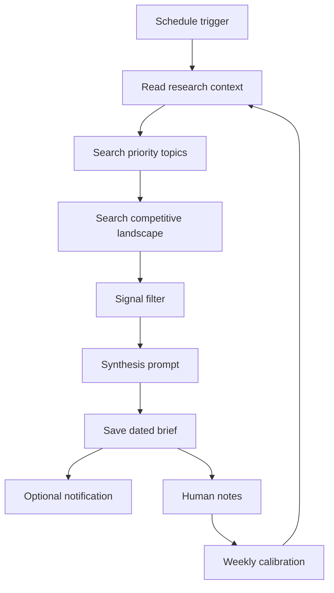
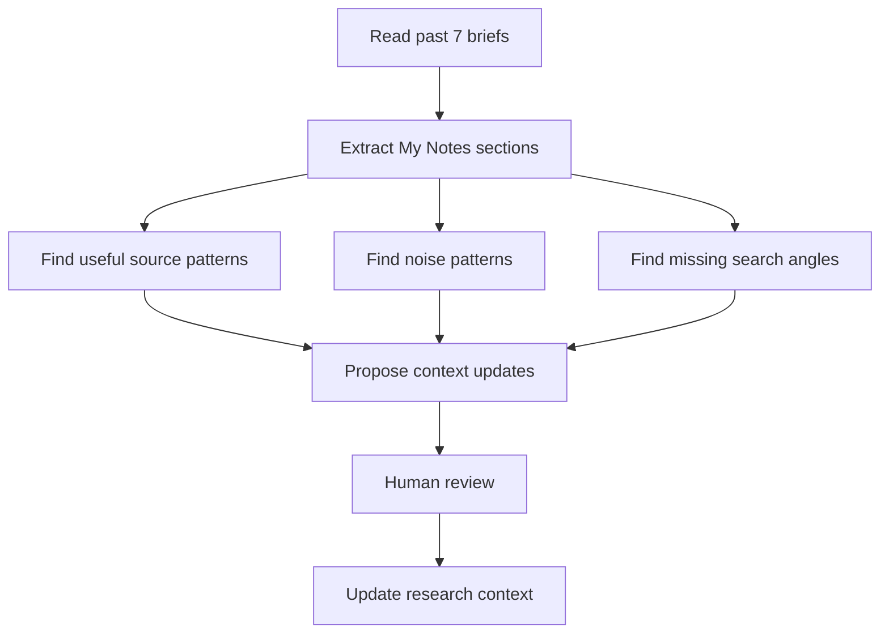

# Research Agent Orchestration

Purpose: define how the Research Agent turns scheduled source monitoring into daily and weekly intelligence artifacts.

## Recommended Architecture

## Implementation Paths

### Path A: Claude Desktop Manual Run

Use when you want a low-infrastructure first version.

Requirements:

- Claude Desktop
- Filesystem MCP scoped to the vault
- Brave Search MCP with `BRAVE_API_KEY`
- `CLAUDE.md` or research context file in the vault
- `BRIEFINGS/` folder in the vault

Run the prompt in `templates/morning-research-agent-prompt.md` manually or via an approved local automation that can operate Claude Desktop.

### Path B: n8n Scheduled Workflow

Use when you want the brief generated automatically every morning.

Requirements:

- n8n self-hosted or managed instance
- Anthropic API key
- Brave Search API key or approved search connector
- File write access to the vault location, or a safe destination such as Drive, GitHub, or local mounted storage
- Human-approved production activation

Node shape:

1. Schedule Trigger: `0 6 * * 1-5` for 6 AM weekdays, or `0 6 * * *` for every day.
2. Read Research Context: read `CLAUDE.md` or `research-context.md`.
3. Search Sources: run Brave Search API calls from configured focus areas and competitive landscape terms.
4. Prepare Claude Request: combine search results, source links, and research context.
5. Claude API Call: ask for the brief using the morning prompt.
6. Save Brief: write `BRIEFINGS/YYYY-MM-DD-morning-brief.md`.
7. Optional Notification: send "Morning brief ready" via Telegram, Slack, or the current VCOS notification route.

Important: do not assume Claude Desktop MCP tools are available inside n8n. If n8n calls the Anthropic API directly, n8n must fetch the web results and pass them to Claude, or call an MCP-capable worker that can fetch them.

## Morning Brief Contract

The brief must be:

- short enough to read in 5 minutes
- dated and timestamped
- directly tied to the research context
- sourced with links for included claims
- honest when the day is quiet
- free of generic hype, repeated coverage, and filler

## Weekly Calibration Workflow

Use `templates/weekly-feedback-loop-prompt.md` every Sunday or after several annotated briefs.

## Handoff Packets

Research Agent can hand off:

- to Marketing: market signals, competitor positioning, campaign angles, proof links
- to Sales: account-specific trigger events, prospect-relevant news, objection intelligence
- to Operations: workflow/tooling changes, source reliability issues, dashboard requirements
- to Infrastructure: runtime, credential, scheduling, deployment, and cost concerns

Research Agent does not publish, send, mutate CRM records, buy tools, or activate production workflows without human approval.
