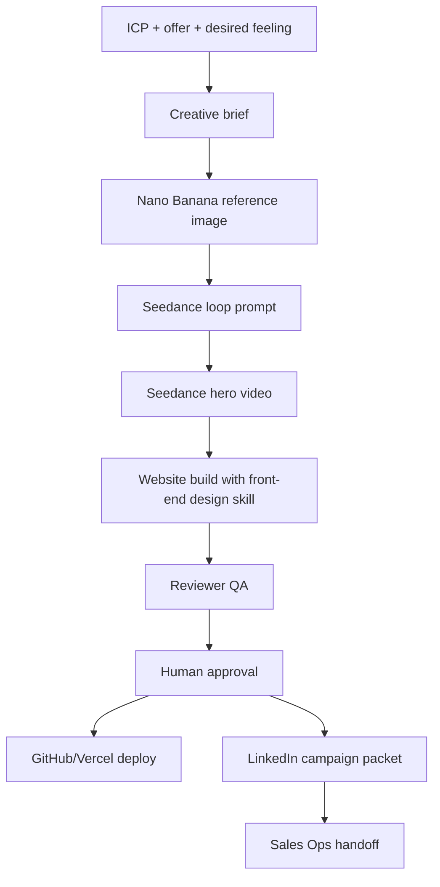
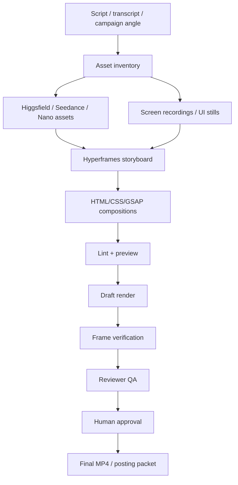
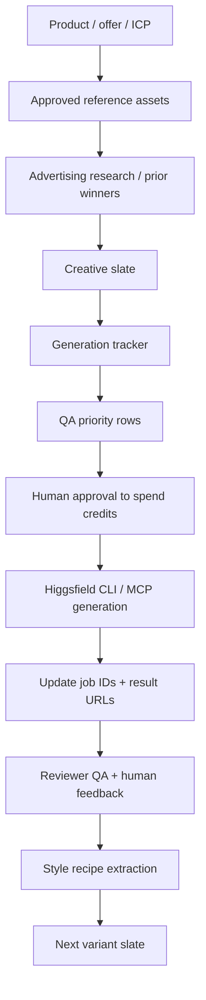
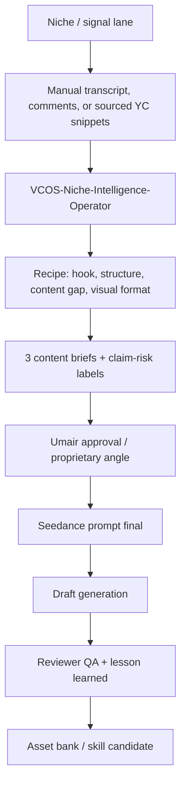

# Marketing Orchestration

Purpose: show how Marketing combines capabilities into revenue workflows.

## Website + Campaign Workflow

Use when Marketing needs to build a demo website and campaign around an ICP.

## Handoff To Sales Ops

Marketing sends Sales Ops only:

- ICP
- offer angle
- asset links
- hook and CTA
- proof claims requiring source
- approved/rejected status
- recommended DM/proposal angle

Marketing does not send full prompt history unless Sales Ops explicitly needs it.

## Handoff To Operations

Marketing sends Operations only:

- site/page asset requirements
- publishing status
- CMS/webhook needs
- tracking needs
- dashboard/reporting requirements

## Current Priority Capability

`luxury-ai-video-website-builder`

Goal: let the Marketing Mini Intern build Apple/luxury-style demo sites by orchestrating Nano Banana, Seedance, front-end design, GitHub, Vercel, and Reviewer QA.

Validation target:

1. Internal architecture-style demo.
2. AgentOSync demo site.
3. Client-style demo such as barber shop AVAPI or Amax campaign page.

## Video Editing / Motion Graphics Workflow

Use Hyperframes when the raw creative assets already exist and Marketing needs a polished video.

Best first use cases:

1. AgentOSync LinkedIn short with captions and motion graphics.
2. Amax WhatsApp/forms insights dashboard walkthrough.
3. Barber AVAPI demo explainer with UI callouts.

## Higgsfield Creative Agency Workflow

Use this when Marketing needs many tracked creative variants instead of one-off media.

Rules:

- Prefer CLI for Claude Code batch workflows when available; MCP is fine for Claude web/chat.
- Product ads must use approved reference assets and product fidelity constraints.
- Generate 3-5 priority rows first; do not blindly run a whole slate.
- Every generated asset gets status, prompt, job ID, result URL, QA result, and lesson learned.
- Winners become style recipes; repeated style recipes become skill candidates.

## Hermes Niche Intelligence + Seedance Backlog Workflow

Use this when Marketing needs to convert creator research, YC/company signals, and audience comments into Seedance-ready content briefs.

Rules:

- Start with manual data collection.
- YC signals are strategic framing inputs, not investment advice.
- Do not use "top startup" claims unless the criterion is stated.
- Do not imply a company endorses AgentOSync.
- Do not launch public niche accounts or schedules from this workflow without approval.
- **Higgsfield/browser safety (2026-06-19):** Generate via `higgsfield auth login` + CLI or user-driven MCP OAuth only. Never run `gstack/bin/chrome-cdp` or quit/kill the user's browser to "reuse" a session. Incident: `3_Project_Workspaces/3.1_AgentOSync_Revenue_Pipeline/03_gtm_campaigns/higgsfield/browser-session-incident-2026-06-19.md`.
