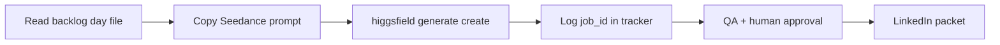

# Claude Code + Higgsfield Setup (NeuralSync Marketing Intern)

How to access the HQ repo and run Seedance generation from Claude Code without breaking browser sessions.

## 1. Open The Repo

```bash
# HQ intern worktree (this folder)
cd /Users/umairkhalid/.grok/worktrees/umairkhalid-vcos-headquarters/vcos-employee-ns-marketing-intern

# Or canonical HQ clone
cd /Users/umairkhalid/_VCOS_Headquarters
```

GitHub: `https://github.com/WEB3X100/vcos-hq`

## 2. Load Intern Context

Tell Claude Code:

```
Read 7_VCOS_Interns/7.1_NeuralSync_Marketing_Intern/AGENTS.md
Then open today's backlog day file in content-backlog/week-2026-06-20-to-06-27/
Run Seedance generation for approved rows only. Update generation-tracker.csv after each job.
```

## 3. Higgsfield Auth (Preferred)

```bash
higgsfield auth login    # one-time browser OAuth
higgsfield account status
```

Account confirmed: `info@agentosync.com` — Ultimate plan.

## 4. MCP OAuth (Claude Web Alternative)

If using Claude in browser instead of CLI:

1. Open `/mcps` in Claude
2. Find **higgsfield** server
3. Complete OAuth authenticate
4. Use `generate_video` with `model: seedance_2_0`

## 5. Browser — What NOT To Do

**Blocked** (2026-06-19 incident — mass browser logouts):

- `gstack/bin/chrome-cdp`
- Quitting/killing Chrome to reuse profile
- GStack cookie-import that closes active session

**Safe alternatives:**

- Higgsfield CLI (`higgsfield auth login`)
- User generates manually in Higgsfield UI while agent writes prompts
- MCP OAuth in Claude web

## 6. VCOS-Employee Writer Repo

For script/JSON briefs:

```bash
cd /Users/umairkhalid/VCOS-Employee/VCOS_Neural_Sync/Employee_02_Writer
# Read CLAUDE.md + swipe files before drafting
```

GitHub: `https://github.com/WEB3X100/VCOS-Employee`

## 7. Daily Loop



## 8. File Locations After Sprint

| Output | Store |
| --- | --- |
| Rendered MP4 | `outputs/seedance-sprint-2026-06-20/` (local) or Drive when synced |
| Tracker | `generation-tracker.csv` in intern folder |
| Approved captions | Each day file's `linkedin-packet` section |